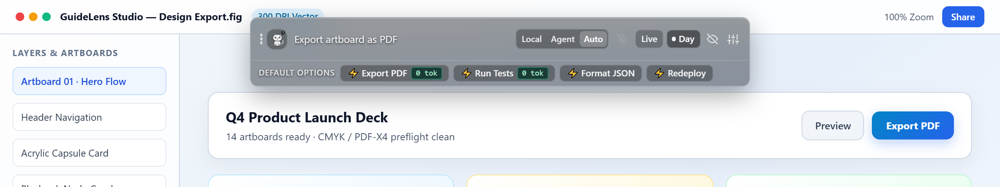
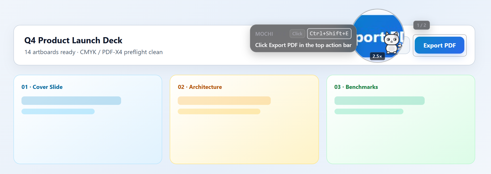
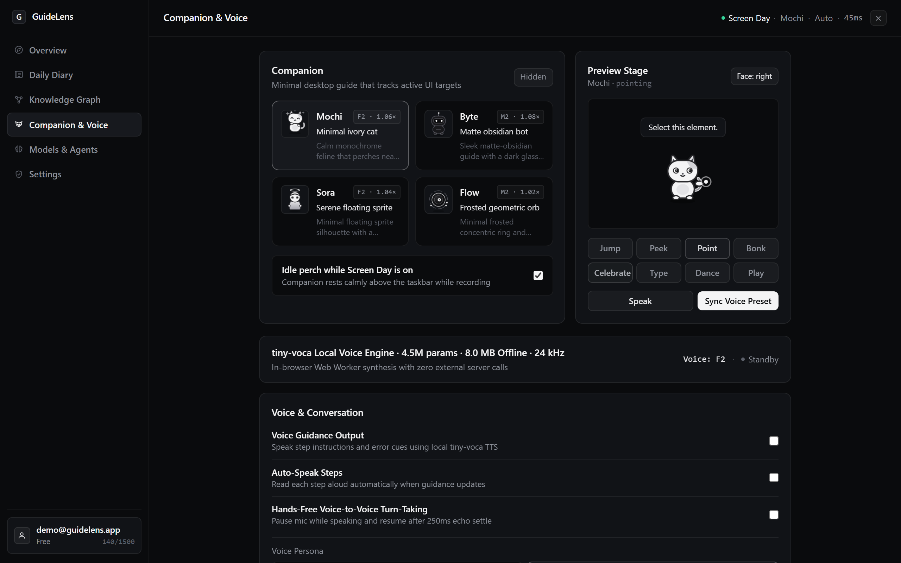
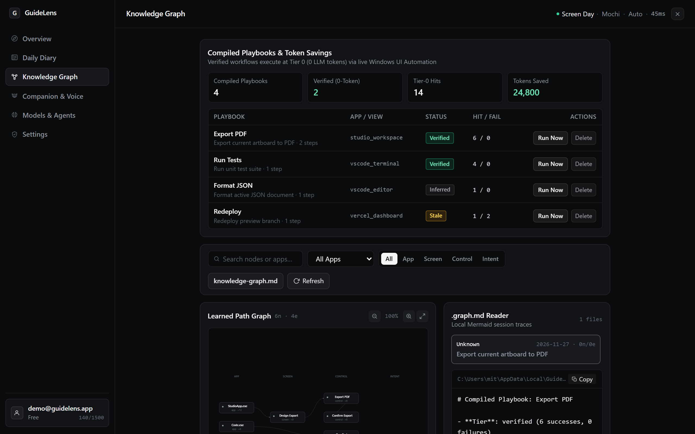

# GuideLens — Windows AI On-Screen Copilot & Agent Visual Bridge

[](https://joking-really.github.io/GuideLens/)
[](https://youtu.be/x-D5DxyOj_k)
[](https://github.com/joking-really/GuideLens/releases/latest)
[](LICENSE)

[Live Landing Page](https://joking-really.github.io/GuideLens/) · [3-Min Demo Video](https://youtu.be/x-D5DxyOj_k) · [Latest Windows Download v2.3.0](https://github.com/joking-really/GuideLens/releases/latest) · [MIT License](LICENSE)

**GuideLens** is a low-latency Windows 10/11 desktop copilot with native **DWM Acrylic frosted glass**, **Zero-Token Compiled Playbooks** via live **Windows UI Automation**, 1-click **Default Options**, and a local **MCP visual bridge** (`guidelens-mcp`) for AI coding and desktop agents.



---

## What's New in v2.3.0

- **True Windows DWM Acrylic Glass (`apps/desktop/src-tauri/src/window_glass.rs`)**: Translucent native Windows 10/11 frosted acrylic blur behind the floating command bar with live toggle and `12%–65%` tint opacity control in Settings.
- **Zero-Token Compiled Playbooks (`apps/desktop/src-tauri/src/memory/compiler.rs`)**: Promotes verified multi-step workflows into SQLite v3 playbooks (`kg_playbooks` + `kg_playbook_steps`) that replay at **Tier 0 (`0` LLM tokens)** using live UI Automation, complete with `Re-ask AI` and 👍/👎 feedback.
- **1-Click Default Options**: Instant `⚡` action pills inside the command bar (`0 tok` for verified playbooks) and a **Compiled Playbooks & Token Savings** dashboard in the Knowledge Graph tab.

---

## Download & Run in 60 Seconds (Windows 10/11 x64)

| Artifact | Link | Notes |
|---|---|---|
| **Windows Executable** | [`GuideLens-v2.3.0-windows-x64.exe`](https://github.com/joking-really/GuideLens/releases/download/v2.3.0/GuideLens-v2.3.0-windows-x64.exe) | Single standalone Windows x64 binary |
| **Portable ZIP Bundle** | [`GuideLens-v2.3.0-windows-x64.zip`](https://github.com/joking-really/GuideLens/releases/download/v2.3.0/GuideLens-v2.3.0-windows-x64.zip) | Includes `GuideLens.exe`, `README.md`, `LICENSE`, `QUICKSTART.txt` |
| **Checksums** | [`SHA256SUMS.txt`](https://github.com/joking-really/GuideLens/releases/download/v2.3.0/SHA256SUMS.txt) | SHA-256 verification hashes |

### Quick Start
1. **Download** [`GuideLens-v2.3.0-windows-x64.exe`](https://github.com/joking-really/GuideLens/releases/download/v2.3.0/GuideLens-v2.3.0-windows-x64.exe) (or extract `GuideLens-v2.3.0-windows-x64.zip` and launch `GuideLens.exe`).
2. **Run `.exe`**: Because open-source community builds are unsigned, Windows SmartScreen may show *"Windows protected your PC"*. Click **More info** -> **Run anyway**.
3. **Press `Ctrl + Space`** anywhere on Windows to summon the `640×54` translucent Acrylic command bar (`Ctrl + Shift + Space` fallback) and click a `⚡` Default Option or type any task.
4. **Choose your Brain** in onboarding or Settings:
   - **Local Ollama (`local_vlm`)**: 100% offline vision (`qwen2.5vl:3b` default, `qwen2.5vl:7b`, `llama3.2-vision`).
   - **BYO API Key (`byo_api`)**: Gemini, OpenAI, Anthropic, Groq, or OpenRouter stored in **Windows Credential Manager**.
   - **Agent CLI (`agent_cli`)**: Headless invocation of installed CLIs (`claude`, `codex`, `gemini`, `agy`, `hermes`).

---

## Click-Through Overlay & Living Companions



- **Click-Through Virtual-Desktop Overlay**: Transparent window (`WS_EX_TRANSPARENT | WS_EX_LAYERED | WS_EX_TOOLWINDOW | WS_EX_NOACTIVATE`) with DPI-aware multi-monitor coordinate mapping, step badges, a 2.5× magnifier lens, and one-click **Copy** terminal command cards.
- **Hybrid UIA + VLM Target Locator**: Snaps bounding boxes to live **Windows UI Automation (`IUIAutomation`)** controls via fuzzy matching (`strsim`), falls back to normalized `0–1000` VLM coordinates when confidence `>= 0.5`, or degrades cleanly to text-only guidance.
- **Smart Auto-Advance**: Global `WH_MOUSE_LL` hook detects when you click inside the highlighted target control (or when the foreground window changes) and advances to the next step automatically.
- **15 Priority Windows App Profiles**: Built-in layout and shortcut context for Photoshop, Excel, PowerPoint, Google Docs, Word, Canva, Premiere Pro, After Effects, VS Code, GitHub Desktop, Terminal, OpenCode, Antigravity, Windows Settings, and Chrome.

### Living Companions (`apps/desktop/src/companions/personas.ts`)



Choose an interactive on-screen companion (with optional local `tiny-voca` voice cues) or switch to `Hidden` stealth mode:

| Companion | ID | Style | Default Voice |
|---|---|---|---|
| **Mochi** | `pixel_cat` | Studio Cat — minimal ivory feline | `F2` |
| **Byte** | `tech_nerd` | Obsidian Bot — matte obsidian visor bot | `M2` |
| **Sora** | `anime_guide` | Halo Sprite — serene floating halo sprite | `F2` |
| **Flow** | `minimal_orb` | Concentric Orb — frosted geometric ring | `M2` |

---

## Global Shortcuts (`apps/desktop/src-tauri/src/input/mod.rs`)

| Hotkey | Action | Description |
|---|---|---|
| `Ctrl + Space` | `toggle_bar` | Toggle floating command bar visibility and focus (`Ctrl + Shift + Space` fallback) |
| `Ctrl + Alt + H` | `toggle_bar_only` | Hide or show the top bar while keeping the companion visible (companion-only mode) |
| `Ctrl + Alt + M` | `toggle_mic` | Toggle Microphone On/Off |
| `Ctrl + Alt + L` | `toggle_live` | Toggle Live Guidance Session |
| `Ctrl + Alt + D` | `toggle_day` | Toggle Screen Day recording |
| `Ctrl + Alt + O` | `use_local` | Switch brain mode to **Use Local** (`local_vlm`) |
| `Ctrl + Alt + A` | `use_agent` | Switch brain mode to **Use Agent** (`agent_cli`) |
| `Esc` | `clear_overlay` | Clear active overlay guidance and release `WH_MOUSE_LL` / `WH_KEYBOARD_LL` hooks |

---

## 5 Interchangeable Brains (`BrainKind`)

| Brain Mode | Backend | How It Works |
|---|---|---|
| `local_vlm` | **Ollama (Offline)** | Runs locally at `127.0.0.1:11434` with `qwen2.5vl:3b` (default), `qwen2.5vl:7b`, or `llama3.2-vision` and 1-click model pull. |
| `byo_api` | **BYO API Key** | Supports `gemini`, `openai`, `anthropic`, `groq`, and `openrouter`; keys are stored exclusively in **Windows Credential Manager** (`keyring`). |
| `agent_cli` | **Headless Agent CLI** | Auto-detects installed CLIs (`claude`, `codex`, `gemini`, `agy`, `hermes`) and invokes them headlessly with screen context. |
| `agent_mcp` | **MCP Visual Bridge** | Lets external agents drive GuideLens's capture and overlay over localhost (`127.0.0.1:47615`, bearer token). |
| `groq_pro` | **GuideLens Cloud Pro** | Managed FastAPI proxy backed by high-speed Groq Vision inference. |

When `brain_mode` is set to `auto`, GuideLens routes in order: `Connected Agent CLI -> BYO API Key -> Groq Pro -> Local Ollama VLM`.

---

## Knowledge Graph + Screen Day



- **Compiled Playbooks & Self-Improving Knowledge Graph** (`apps/desktop/src-tauri/src/memory/`): Compiles verified workflows into SQLite v3 Tier-0 playbooks (`0` LLM tokens) and human-readable `.graph.md` / Mermaid files, tracking token savings and replaying matched controls directly via UI Automation.
- **Screen Day Tracker** (`apps/desktop/src-tauri/src/screenday/`): Toggleable (`Ctrl + Alt + D`) visual work diary with dHash perceptual deduplication, local OCR indexing, automatic project/meeting classification, and a built-in **Privacy Shield** that skips password managers, private browsing windows, and Windows lock/UAC/credential prompts.

---

## MCP Bridge Setup (`guidelens-mcp`)

External agents (**Claude Code**, **Antigravity**, **ChatGPT Codex**, **Gemini CLI**, **Hermes**) can control GuideLens via `packages/guidelens-mcp` over stdio MCP. When the GuideLens desktop app launches, it binds strictly to `127.0.0.1:47615` and writes `%LOCALAPPDATA%\GuideLens\bridge.json` with a random 32-byte bearer token.

```powershell
cd packages/guidelens-mcp
npm install
npm run build
npm test

# Auto-generate or write MCP config for your agent:
# <agent> = claude | codex | gemini | antigravity | hermes
node dist/cli.js install claude --write
```

Exposed MCP tools: `capture_screen`, `highlight`, `show_command`, `guide`, `clear`. See [MCP Setup Guide](docs/mcp-setup.md) for manual configs and standalone CLI commands.

---

## Build from Source

Prerequisites on Windows 10/11 x64: **Rust** (`stable-x86_64-pc-windows-msvc`), **VS 2022 C++ Build Tools**, **Node.js 20+**, and **Python 3.12+** (for cloud proxy & benchmarks).

```powershell
# 1. Desktop App (Tauri v2 + React 18)
cd apps/desktop
npm install
npm run tauri dev          # Development mode
npm run tauri build        # Production NSIS (.exe) + MSI (.msi) installers

# 2. Desktop Tests & Checks
npx tsc --noEmit
npx vitest run
cd src-tauri
cargo clippy --all-targets -- -D warnings
cargo test

# 3. Local MCP Server & CLI
cd ../../packages/guidelens-mcp
npm install
npm run build
npm test

# 4. Cloud Proxy (FastAPI + Pytest)
cd ../../services/cloud
pip install -r requirements.txt
pytest -q

# 5. Visual Accuracy IoU Benchmark
cd ../..
python benchmarks/run_benchmark.py --validate-only
```

---

## Repository Layout & Docs

```text
GuideLens/
├── apps/desktop/                 # Tauri v2 (Rust) + React 18 + TypeScript + Tailwind desktop app
├── packages/guidelens-mcp/       # Node/TypeScript stdio MCP server + standalone CLI
├── services/cloud/               # FastAPI Groq Vision proxy + Supabase Auth/RLS + Stripe
├── benchmarks/                   # Visual accuracy IoU benchmark harness + cases
├── website/                      # GitHub Pages landing site (deployed via .github/workflows/pages.yml)
└── docs/                         # Setup, brains, MCP, cloud deploy, and signing docs
```

- [Getting Started on Windows 10/11](docs/getting-started.md)
- [Configuring Brains](docs/configuring-brains.md)
- [MCP Server & CLI Setup](docs/mcp-setup.md)
- [Cloud Proxy Deployment](docs/cloud-deploy.md)
- [Code Signing & Auto-Updater](docs/code-signing-and-updater.md)
- [Visual Accuracy Benchmark](benchmarks/README.md)
